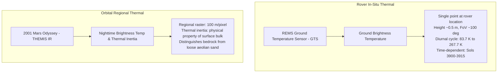

# MARSWALK — Thermal Data Specification & Sensor Distinctions

> **Target Region:** Mount Sharp Boxwork Formations, Gale Crater, Mars  
> **Component:** Gaddielle (Data Engineering & Planetary Science Specialist, [W2](../../docs/team/GADDIELLE.md))  

---

## 1. Strict Scientific Distinction: Rover-Local vs Orbital Thermal Measurements

MARSWALK maintains a fundamental physical distinction between rover in-situ thermal telemetry and orbital thermal observations. Under no circumstances are these two datasets merged into a single surface-temperature map.

| Property | Curiosity REMS GTS (In-Situ) | Mars Odyssey THEMIS IR (Orbital) |
| :--- | :--- | :--- |
| **Physical Quantity** | Ground surface brightness temperature ($T_{g}$) | Thermal infrared radiance, brightness temperature, bulk thermal inertia ($I = \sqrt{k\rho c}$) |
| **Sensor Elevation** | ~0.5 m on rover mast boom | ~400 km sun-synchronous orbit |
| **Spatial Footprint** | Local spot (~few meters diameter below rover) | Regional grid: 100 meters/pixel |
| **Temporal Sampling** | 1 Hz during active sessions across full diurnal cycle (16 sols) | Periodic orbital overpasses (daytime ~15:00 LTST, nighttime ~03:00 LTST) |
| **Physical Interpretation** | Instantaneous skin temperature of immediate soil/rock patch | Bulk thermal inertia: ability of surface materials to retain heat (bedrock vs fine dust) |
| **Map Application** | Atmospheric/microclimate boundary baseline | Regional thermophysical hazard/substrate characterization |

---

## 2. Clarification of THEMIS Product `PIA14290`

* **Catalog ID:** `PIA14290` (NASA Planetary Photojournal)
* **Title:** *Gale Crater: Future Home of Mars Rover Curiosity*
* **Release Date:** July 22, 2011
* **Instrument:** Thermal Emission Imaging System (THEMIS), 2001 Mars Odyssey (operated by Arizona State University)
* **Critical Clarification regarding `PIA14290`:**
  - While compiled from THEMIS data, `PIA14290` is a **visible-light mosaic presentation** (VIS context overview) showing the 154 km crater and the MSL landing ellipse.
  - It is **not** a quantitative thermal inertia or calibrated brightness temperature raster.
  - It does not contain floating-point thermal emission values, temperature bands, or calibrated radiometric units ($J \cdot m^{-2} \cdot K^{-1} \cdot s^{-1/2}$).
* **Authoritative Quantitative Thermal Datasets for Gale Crater:**
  - Standard THEMIS calibrated products for Gale Crater are hosted via ASU/USGS:
    - *THEMIS Night IR 100m Global Mosaic* (`thm_nightir_100m`)
    - *THEMIS Quantitative Thermal Inertia Mosaic* (Fergason et al. 2006, 2012; USGS Astropedia)
  - *Spatial Resolution:* 100 meters per pixel.
  - *Thermophysical Inferences for Boxwork:* Consolidated bedrock boxwork ridges possess elevated thermal inertia ($I \approx 350-500 \, \text{tiu}$), retaining heat into the Martian night and appearing bright in nighttime IR. In contrast, loose aeolian sand dunes filling hollows exhibit low thermal inertia ($I \approx 150-250 \, \text{tiu}$), rapidly cooling after sunset and appearing dark.
* **Evaluation for Runtime:**
  - *Status:* **Available but Unprocessed** (Regional context).
  - *Limitation:* At 100 m/pixel, a single pixel averages scores of individual boxwork ridges and hollows together. It provides thermophysical confirmation of consolidated rock versus loose sand, but cannot resolve meter-scale temperature variations along an EVA astronaut's path.
