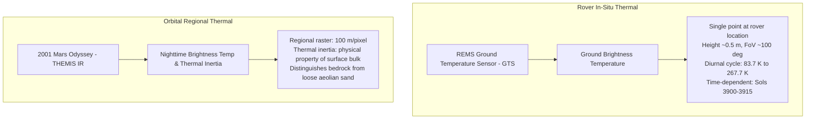

# MARSWALK — Thermal Data Specification & Sensor Distinctions

> **Target Region:** Mount Sharp Boxwork Formations, Gale Crater, Mars  
> **Component:** Gaddielle (Data Engineering & Planetary Science Specialist, [W2](../../docs/team/GADDIELLE.md))  

---

## 1. Strict Scientific Distinction: Rover-Local vs Orbital Thermal Measurements

MARSWALK maintains a fundamental physical distinction between rover in-situ thermal telemetry and orbital thermal observations. Under no circumstances are these two datasets merged into a single surface-temperature map.

| Property | Curiosity REMS GTS (In-Situ) | Mars Odyssey THEMIS IR (Orbital) |
| :--- | :--- | :--- |
| **Physical Quantity** | Ground surface brightness temperature ($T_{g}$) | Thermal infrared radiance, brightness temperature, thermal inertia ($I = \sqrt{k\rho c}$) |
| **Sensor Elevation** | ~0.5 m on rover mast boom | ~400 km sun-synchronous orbit |
| **Spatial Footprint** | Local spot (~few meters diameter below rover) | Regional grid: 100 meters/pixel |
| **Temporal Sampling** | 1 Hz during active sessions across full diurnal cycle (16 sols) | Periodic single-time orbital overpasses (daytime ~15:00 LTST, nighttime ~03:00 LTST) |
| **Physical Interpretation** | Instantaneous skin temperature of immediate soil/rock patch | Bulk thermal inertia: ability of surface materials to retain heat (bedrock vs fine dust) |
| **Map Application** | Atmospheric/microclimate boundary baseline | Regional thermophysical hazard/substrate characterization |

---

## 2. Authoritative Orbital Thermal Candidate: THEMIS Gale Crater Mosaic

* **Product Title:** Gale Crater THEMIS Daytime and Nighttime Infrared Mosaics
* **Instrument:** Thermal Emission Imaging System (THEMIS), 2001 Mars Odyssey
* **Catalog Identifier:** `PIA14290` (NASA Planetary Photojournal)
* **Publisher / Host:** Arizona State University (ASU) Mars Space Flight Facility / NASA JPL
* **Catalog Landing Page:** [https://photojournal.jpl.nasa.gov/catalog/PIA14290](https://photojournal.jpl.nasa.gov/catalog/PIA14290)
* **Archive Repository:** ASU THEMIS Data Archive / JMARS ([https://themis.asu.edu/](https://themis.asu.edu/))
* **Spatial Resolution:** 100 meters per pixel
* **Geographic Coverage:** Full Gale Crater floor and Mount Sharp central mound (~154 km diameter, centered at 4.5°S, 137.4°E)
* **Scientific Insights for Boxwork Region:**
  * Boxwork ridge networks appear with elevated thermal inertia relative to surrounding dark sand dunes, confirming that the mineralized ridges consist of dense, cemented bedrock that retains daytime solar heat into the cold Martian night.
* **Evaluation for Runtime:**
  * *Status:* **Available but Unprocessed** (Regional context).
  * *Limitation:* At 100 m/pixel, a single THEMIS pixel spans approximately 50 to 100 individual boxwork ridges. It provides thermophysical confirmation of consolidated rock versus loose sand, but cannot resolve meter-scale temperature variations along an EVA astronaut's footsteps.
