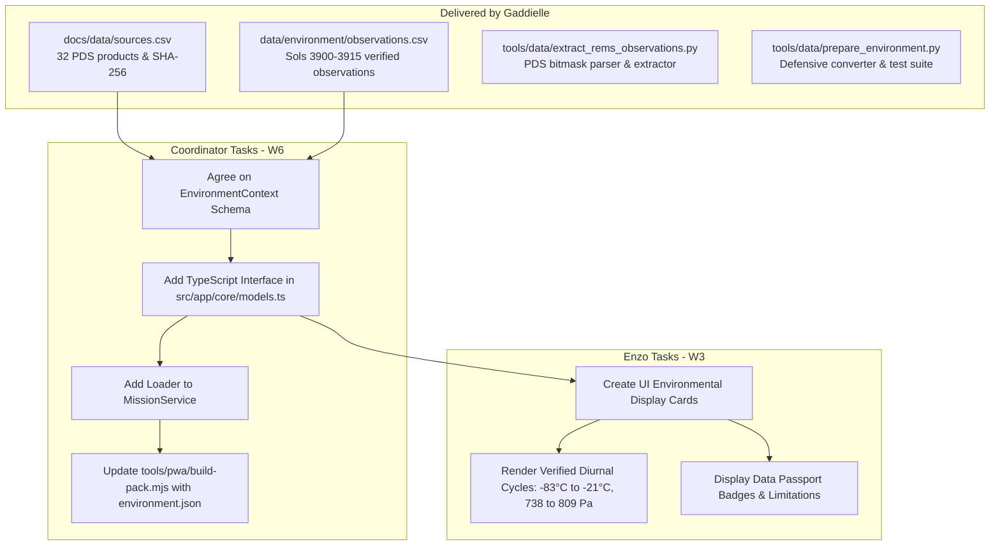

# MARSWALK — Integrated Data Delivery & Provenance Specification

> **Deliverable**: Comprehensive Data Inventory, Calibration Analysis, Elevation Feasibility & Handoff  
> **Prepared by**: Gaddielle (Data Engineering & Imagery Specialist, [W2](../../TEAM_TASKS.md#w2))  
> **Audience**: Coordinator (YOU, [W6](../../TEAM_TASKS.md#w6)) and Enzo ([W3](../../TEAM_TASKS.md#w3))  
> **Branch**: `feature/gaddielle-environment-data`  

---

## 1. Executive Summary & Dataset Classification

Every dataset across imagery, environmental telemetry, and elevation is classified into one of three strict scientific tiers:

| Dataset | Scope / Coverage | Classification | Status & Operational Role |
| :--- | :--- | :---: | :--- |
| **Primary Visual Map Texture** (`PIA26306_derived_2048.jpg`) | Lower Mount Sharp Boxwork (`2048 × 1042 px`) | **Verified and Ready for Review** | Active 2D/3D map texture. Coordinate convention: `image-pixels-bottom-left`. |
| **Mission Manifest** (`manifest.json`) | Map metadata & boundaries | **Verified and Ready for Review** | Client runtime index; references active `imageRef`. |
| **Science Markers** (`markers.json`) | Curiosity traverse context | **Verified and Ready for Review** | Context markers (Emma's deliverable). |
| **Image-Pack Control** (`image-pack.json`) | Offline payload index | **Verified and Ready for Review** | Build/cache control file (524,472 B image pack). |
| **REMS Daily Observations** (`observations.csv`) | Sols 3900–3915 Gale Crater | **Verified and Ready for Review** | 484,604 row records extracted from official NASA PDS MODRDR tables. Independent quality bitmasks and sample counts. |
| **Image Ground Calibration** | Pixel-to-ground scale ($m/\text{pixel}$) | **Unverified — Excluded from Runtime** | Visual public release (`PIA26306`) lacks projective transformation history; metric scaling disabled (`calibration.verified: false`). |
| **Digital Elevation Model (DEM)** | HiRISE DTM `DTEEC_001488_...` | **Unavailable — Documented Gap** | Sourced authoritative DTM identified (1.01 m/px, 360 MB), but excluded from v1 PWA payload; 3D viewer renders flat plane with visual review fallback. |
| **Runtime Environment JSON** (`environment.json`) | PWA environmental signal | **Unverified — Excluded from Runtime** | Awaiting Coordinator shared TypeScript contract and schema sign-off before runtime generation. |

---

## 2. Phase 2 — Image Calibration Investigation (Mount Sharp Boxwork)

### A. Primary Provenance & Product Identification
- **Catalog ID:** `PIA26306` (NASA Planetary Photojournal)
- **Parent Observation ID:** `PSP_001752_1750`
- **Orbiter & Instrument:** Mars Reconnaissance Orbiter (MRO) / High Resolution Imaging Science Experiment (HiRISE)
- **Principal Investigator:** Alfred McEwen, Lunar and Planetary Laboratory, University of Arizona
- **Acquisition Date:** 2006-12-10 (15:41 Mars Local Time)
- **Public Release Date:** 2024-02-13 (NASA JPL Photojournal)
- **Target Center Footprint:** Latitude: `-4.843°` (`4.843°S`), Longitude: `137.298°E` (Areocentric, Mars 2000 datum)

### B. Geometric Lineage & Transformation Analysis
1. **Archival Orbital Observation (`PSP_001752_1750_RED.JP2`):**
   - Projected in Equirectangular projection (clat = -4.83°, clon = 137.3°E).
   - Documented native pixel scale: ~0.25 to 0.28 meters/pixel.
2. **JPL Photojournal Public Presentation (`PIA26306.jpg`):**
   - Published dimensions: `7488 × 3813` pixels (2,658,965 bytes).
   - This release is a **contrast-enhanced visual crop** oriented for public scientific demonstration.
   - **Crucial Finding**: The crop offsets, resampling kernel, and rotational alignment relative to the parent orbital PDS EDR/RDR coordinate frame were **not published** by JPL in the Photojournal release metadata.
3. **Active Web Derivative (`PIA26306_derived_2048.jpg`):**
   - Resampled dimensions: `2048 × 1042` pixels (523,272 bytes, SHA-256: `7b814497d98d7e5fb89dd122c65b01c32e5c2099b039ef62887a606af199bfa8`).
   - Resampled via GDI+ bicubic filtering from `PIA26306.jpg`.
   - **Calibration Decision**: Without ground tie-points or an official world file tying pixel $(x, y)$ to Areocentric $(lat, lon)$, **a reproducible pixel-to-ground metric scale cannot be scientifically certified**.
   - **Status**: Formally marked as **`calibration.verified: false`**, `metersPerPixel: null`.
   - **Coordinate Contract**: Preserves the stable internal convention `image-pixels-bottom-left` ($0 \le x \le 2048$, $0 \le y \le 1042$, origin at bottom-left corner).

---

## 3. Phase 3 — Authoritative Elevation Data Evaluation

A comprehensive investigation of authoritative Mars elevation products covering the boxwork region of Mount Sharp was conducted:

### Candidate Evaluation Table

| Candidate Product | Provider / Archive | Footprint & Spatial Overlap | Resolution & Vert. Datum | Evaluation & Decision |
| :--- | :--- | :--- | :--- | :--- |
| **HiRISE DTM `DTEEC_001488_1750_001752_1750_U02`** | University of Arizona / NASA PDS | Center: -4.83°N, 137.3°E. Direct stereo overlap with `PSP_001752_1750`. | **1.01 m/pixel** horizontal post spacing. Elevation in meters relative to Mars MOLA areoid. Format: PDS .IMG (360 MB) / GeoTIFF. | **Sourced Authoritative DTM.** Overlaps the target boxwork terrain with sub-meter vertical precision. **Decision: Excluded from v1 runtime** due to 360 MB payload size violating the offline PWA budget (target < 2 MB). Documented for v2 pipeline. |
| **HRSC Gale Crater Regional DTM (`DA4`)** | ESA / DLR / Freie Universität Berlin | Covers broad Gale Crater floor and rim (~150 km wide). | **50 m/pixel** horizontal spacing. Vertical precision ~10 m. | **Rejected for local EVA.** 50 m/pixel is too coarse to resolve boxwork ridge relief or traversal obstacles. |
| **MOLA Global MEGDR (`megt_s_4_128`)** | NASA PDS Geosciences Node | Global topographic grid. | **128 pixels/degree (~463 m/pixel)**. | **Rejected for tactical navigation.** Valid only for broad regional elevation context (-4.4 km). |

### Elevation Handling in Application
- **V1 Contract**: `terrainStatus: 'unavailable'`
- Visual brightness is strictly never used as a proxy for terrain elevation or slope.
- Three.js 3D rehearsal renders a flat plane (`Y = 0`) with the warning badge: *"No verified terrain; elevation unavailable"*.

---

## 4. Phase 4 — Environmental Data & Handoff Specification

### Delivered Assets & Provenance
1. **Raw PDS MODRDR Tables (16 Sols: 3900–3915)**:
   - Sourced from NASA PDS Atmospheres Node (`mslrem_1001`).
   - Cataloged in [`docs/data/sources.csv`](sources.csv) with download URLs, byte sizes, and SHA-256 hashes.
2. **Verified Daily Observations Table**:
   - Located at [`data/environment/observations.csv`](../../data/environment/observations.csv).
   - Extracted from 484,604 row observations using [`tools/data/extract_rems_observations.py`](../../tools/data/extract_rems_observations.py).
   - Independent quality tracking: `pressure_valid_count`, `pressure_nominal_quality_count`, `air_temp_valid_count`, `air_temp_nominal_quality_count`, `ground_temp_valid_count`, and `ground_temp_nominal_quality_count`.
   - Legitimate physical zeros (`0.0`) are preserved; uncalibrated sentinels (`-999.00`) are excluded.

### Handoff Requirements for Coordinator & Enzo

1. **Coordinator Responsibilities (YOU, W6)**:
   - Formally approve the proposed `EnvironmentContext` schema (version 1) detailed in `ENVIRONMENT_SOURCE_AUDIT.md`.
   - Add the agreed TypeScript interface to `src/app/core/models.ts`.
   - Wire the environmental data loader into `MissionService`.
   - Include `public/data/environment.json` in `tools/pwa/build-pack.mjs` and verify service worker cache registration.
2. **Enzo Responsibilities (W3)**:
   - Bind the verified temperature range (-83.1°C to -21.0°C) and pressure range (738.5 Pa to 809.4 Pa) into the UI environment cards.
   - Display honest scientific badges: `Verified Archival (Curiosity REMS)` for atmospheric conditions; `Unavailable` for route radiation accumulation and terrain elevation.

---

## 5. Phase 5 — Prioritized Project Status & Outstanding Functionality

Reviewing current Git history and team deliverables, the prioritized outstanding MARSWALK roadmap is:

1. **Priority 1: Environmental Schema Agreement & Runtime Hookup (Coordinator & Enzo)**
   - *Dependency*: Gaddielle delivered verified data; Coordinator must provide TypeScript models; Enzo consumes in UI.
   - *Blocker*: Pending Coordinator approval of `EnvironmentContext` interface.
2. **Priority 2: 2D Route Planning & Viewport Controls (Willy)**
   - *State*: Basic Leaflet map renders texture; waypoint placement, distance readout (pixel coordinates), and route reset underway.
   - *Dependency*: Strictly uses `image-pixels-bottom-left` coordinate contract.
3. **Priority 3: 3D Rehearsal Surface Alignment (Longla)**
   - *State*: Three.js viewer renders flat plane; needs path alignment using agreed center-origin transform (`scene.X = x - 1024`, `scene.Z = 521 - y`).
4. **Priority 4: Science Markers & Discovery Workspace (Emma)**
   - *State*: Context markers (`markers.json`) integrated; evidence filtering and passport drawer need final styling.
5. **Priority 5: Production PWA Cache Verification & Physical Device QA (Coordinator & Royce)**
   - *State*: Build pack generates 17-asset manifest (1.78 MB); physical Android/Chrome home-screen installation and offline verification remain open.

