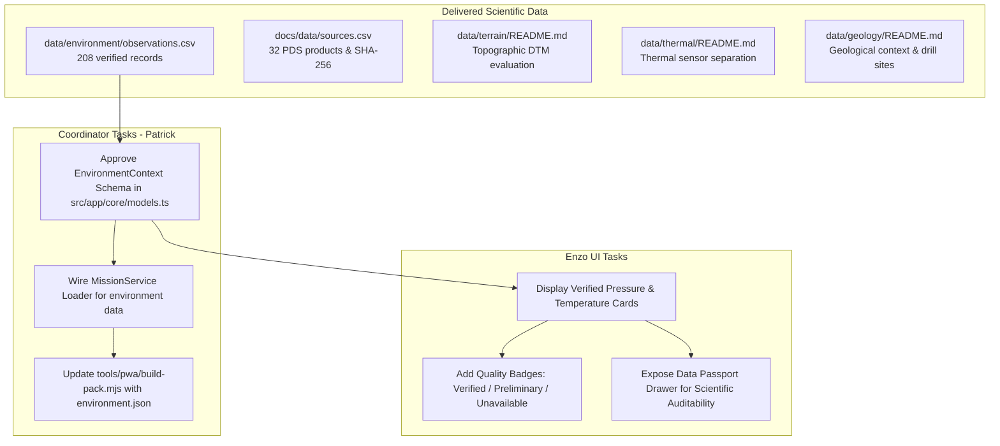

# MARSWALK — Integrated Data Delivery & Provenance Specification

> **Deliverable**: Comprehensive Multi-View Scientific Data Inventory, Calibration Analysis & Integration Handoff  
> **Prepared by**: Gaddielle (Data Engineering & Planetary Science Specialist, [W2](../../TEAM_TASKS.md#w2))  
> **Audience**: Coordinator (Patrick, [W6](../../TEAM_TASKS.md#w6)) and Enzo ([W3](../../TEAM_TASKS.md#w3))  
> **Branch**: `feature/gaddielle-environment-data`  

---

## 1. Multi-View Scientific Data Classification

Every scientific view within MARSWALK (Atmospheric, Thermal, Optical, Topographic, and Geological) is classified into one of four strict scientific tiers:
1. **Verified and Ready for Review**
2. **Available but Unprocessed**
3. **Unverified — Excluded from Runtime**
4. **Unavailable — Documented Gap**

| View | Dataset / Product ID | Instrument / Source | Geographic Coverage | Spatial Resolution | Status Classification | Operational Role & Notes |
| :--- | :--- | :--- | :--- | :---: | :---: | :--- |
| **Atmospheric** | REMS MODRDR Release 0034 (`observations.csv`) | MSL Curiosity REMS / NASA PDS | Sols 3900–3915 Gale Crater (-4.6°S, 137.4°E) | Point rover telemetry (1 Hz) | **Verified and Ready for Review** | 208 records across 13 streams. Sourced from 496,299 raw measurements. Pressure, air temp, ground temp, humidity, UV. |
| **Atmospheric** | Wind Telemetry | MSL Curiosity REMS / NASA PDS | Sols 3900–3915 | Point telemetry | **Unavailable — Documented Gap** | Wind sensor inactive for entire sol window (`WS_CONFIDENCE = 'XXXXXX'`). No fabricated data. |
| **Atmospheric** | Radiation Absorbed Dose | MSL Curiosity RAD / NASA PDS | Gale Crater | Point telemetry | **Unavailable — Documented Gap** | RAD is an independent instrument (`mslrad_1001`); not present in REMS MODRDR. Documented gap for v1. |
| **Thermal (In-Situ)** | REMS Ground Temperature Sensor (`observations.csv`) | MSL Curiosity REMS GTS | Sols 3900–3915 | Immediate rover footprint (~few m) | **Verified and Ready for Review** | Diurnal ground brightness temperature range: 83.7 K to 267.7 K. Separate from orbital thermal data. |
| **Thermal (Orbital)** | THEMIS Gale Crater IR Mosaic (`PIA14290`) | 2001 Mars Odyssey THEMIS | Gale Crater & Mount Sharp (~154 km) | 100 m/pixel | **Available but Unprocessed** | Regional thermophysical context. Confirms high thermal inertia of cemented boxwork ridges vs fine sand. |
| **Optical Imagery** | Primary Map Texture (`PIA26306_derived_2048.jpg`) | MRO HiRISE / NASA Photojournal | Lower Mount Sharp Boxwork (2048 × 1042 px) | Visual display (nominal ~0.25 m in parent) | **Verified and Ready for Review** | Active 2D Leaflet and 3D Three.js visual map texture. Coordinate convention: `image-pixels-bottom-left`. |
| **Optical Calibration**| Pixel-to-ground metric transformation ($m/\text{pixel}$) | Mathematical Derivation / JPL | `PIA26306_derived_2048.jpg` | N/A | **Unverified — Excluded from Runtime** | Visual crop lacks documented projective transformation/kernel history. Metric scale disabled (`calibration.verified: false`). |
| **Topographic (DTM)** | HiRISE DTM `DTEEC_001488_1750_001752_1750_U02` | MRO HiRISE Stereo / UA & PDS | Edge along Gale Crater Interior Mound | 1.01 m/pixel | **Unavailable — Documented Gap** | Sourced authoritative sub-meter DTM (360 MB .IMG) identified and cataloged; excluded from v1 to respect offline PWA mobile budget (< 2 MB). |
| **Topographic (Slope)**| Terrain slope & traversal cost model | Derived from elevation | Boxwork corridor | N/A | **Unavailable — Documented Gap** | Strict rule: slope must never be derived from image brightness. Slope penalties disabled until georeferenced DTM tile integration in v2. |
| **Geological** | Curiosity Boxwork In-Situ Science Context | Curiosity MAHLI, APXS, CheMin, SAM | Sols 4718–4811 Boxwork Ridge Corridor | Sub-millimeter to meter-scale drill targets | **Verified and Ready for Review** | Ground truth from Nevado Sajama (drill target, Sol 4718) and Valle de la Luna. Confirms ancient groundwater sulfate/silica diagenesis. |
| **Geological Map** | Gale Crater Stratigraphic Map (Anderson & Bell 2010) | Orbital CTX/HiRISE/MOLA synthesis | Gale Crater Quadrangle | Regional map units | **Available but Unprocessed** | Authoritative peer-reviewed stratigraphy. No artificial vector polygon boundaries fabricated for client UI. |

---

## 2. Atmospheric & Thermal Handoff

1. **REMS Observations Table (`data/environment/observations.csv`):**
   - 208 verified records adhering to Patrick's schema.
   - Verified diurnal baseline ranges:
     - Atmospheric Pressure: **738.46 Pa to 809.44 Pa** (mean: 768.4 to 798.7 Pa)
     - Ambient Air Temperature: **190.01 K to 252.10 K** (-83.1°C to -21.0°C)
     - Ground Surface Temperature: **83.68 K to 267.67 K** (-189.5°C to -5.5°C)
     - Relative Humidity: **5.1% to 28.3%** (flagged as preliminary quality per PDS bitmask)
     - Ultraviolet Irradiance: Daytime ABC band irradiance present during positive solar elevation.
2. **Thermal Physical Separation:**
   - Ground temperature is documented as a point-in-time rover telemetry reading, distinct from THEMIS 100 m/px orbital bulk thermal inertia. Neither is presented as an interpolated real-time forecast.

---

## 3. Optical Calibration Status

- Active raster: `PIA26306_derived_2048.jpg` (2048 × 1042 px, SHA-256: `7b814497d98d7e5fb89dd122c65b01c32e5c2099b039ef62887a606af199bfa8`).
- Calibration remains **Unverified** (`metersPerPixel: null`, `calibration.verified: false`).
- Bottom-left image pixel coordinate contract is strictly preserved (`image-pixels-bottom-left`).

---

## 4. Topographic & Elevation Data Strategy

- **Authoritative Source Product:** `DTEEC_001488_1750_001752_1750_U02`
  - URL: `http://hirise-pds.lpl.arizona.edu/PDS/DTM/PSP/ORB_001400_001499/PSP_001488_1750_PSP_001752_1750/`
  - Post spacing: 1.01 m/pixel; vertical precision: ~0.25 m.
- **V1 Contract:** Excluded from client bundle to preserve PWA offline budget (< 2 MB). The 3D viewer renders a flat plane ($Y = 0$) with explicit UI warnings.

---

## 5. Geological Context & Boxwork Synthesis

- Detailed context documented in [`data/geology/README.md`](../../data/geology/README.md).
- In-situ ground truth from Curiosity rover Sols 4718–4811 confirms that the boxwork ridges represent mineralized fracture-fill deposits left behind after softer host bedrock was eroded.
- No artificial vector polygons have been invented; science markers remain anchored to verified mission milestones.

---

## 6. Integration Roadmap for Coordinator & Enzo

