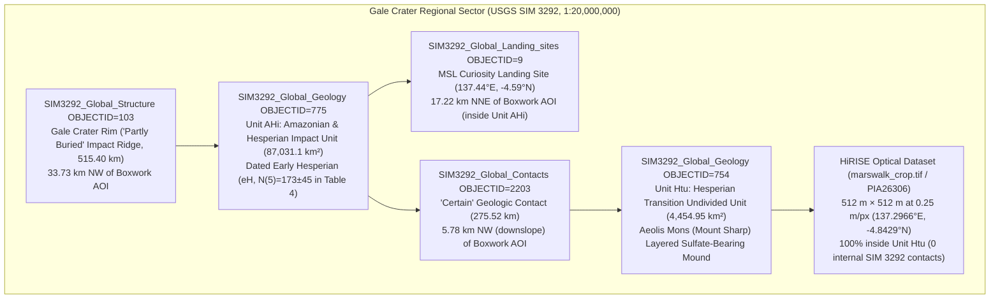

# MARSWALK — USGS Geologic Map of Mars (SIM 3292) Dataset Evaluation & AOI Context Report

> **Dataset & Reference Record (`feature/usgs-sim3292-geology-context`).** Prepared to complement the optical HiRISE dataset (`PSP_001752_1750` / `PIA26306` / `marswalk_crop.tif`) without modifying shared Angular application code (`src/`) or existing runtime data packs (`public/data/`).

---

## Executive Summary

- **Objective:** Obtain a usable, verifiable subset of the **USGS Geologic Map of Mars (Scientific Investigations Map 3292, Tanaka et al., 2014)** for our selected boxwork region on the lower slopes of Mount Sharp (*Aeolis Mons*) in Gale Crater, inspect all available GIS layers, verify their Coordinate Reference Systems (CRS) and geographic coverage, and evaluate whether SIM 3292 provides useful geological context for our Area of Interest (AOI).
- **Delivered Branch Artifacts:**
  1. **[USGS_SIM3292_GALE_AOI.geojson](evidence/USGS_SIM3292_GALE_AOI.geojson)** (`388,740` bytes, SHA-256 `09de70cd83f9183c222126a0430b5cc302139079b8a9972384f6bb014bb8922d`): Standards-compliant GeoJSON `FeatureCollection` in `GCS_Mars_2000_Sphere` containing the 5 primary USGS SIM 3292 vector features governing Gale Crater and Mount Sharp (`Htu` mound polygon `OBJECTID=754`, `AHi` crater impact polygon `OBJECTID=775`, `Certain` basal mound contact `OBJECTID=2203`, Gale Crater rim structure `OBJECTID=103`, and `MSL` Curiosity landing site `OBJECTID=9`) co-registered with the exact `512 m × 512 m` HiRISE boxwork AOI footprint (`marswalk_crop.tif`).
  2. **[USGS_SIM3292_INVENTORY.json](evidence/USGS_SIM3292_INVENTORY.json)**: Machine-readable provenance, layer schema inventory, SHA-256 digests, CRS parameters, point-in-polygon checks, and spherical geodesic distance measurements.
  3. **[extract_sim3292_geology.py](../../tools/data/extract_sim3292_geology.py)** & **[test_extract_sim3292_geology.py](../../tools/data/test_extract_sim3292_geology.py)**: Reproducible Python 3 extraction, coordinate transformation, and verification tooling with automated unit tests.
- **Core Geological Context Finding:**
  - **Regional Context Utility — HIGH (`recommendedRole: "regional-chronostratigraphic-context"`):** SIM 3292 places **100% of our Mount Sharp boxwork AOI** (`137.292283°–137.300921° E, -4.847190° to -4.838553° N`) inside **Unit `Htu` (*Hesperian transition undivided unit*, `OBJECTID = 754`, area `4,454.95 km²`)**, situated **`5.784 km` (`5,784.5 m`) southeast (upslope)** of the `Certain` geologic contact (`OBJECTID = 2203`) with the surrounding Gale Crater floor (**Unit `AHi`, *Amazonian and Hesperian impact unit*, `OBJECTID = 775`**, dated to **Early Hesperian `eH`** in SIM 3292 Table 4) and **`17.217 km` south-southwest** of the **MSL Curiosity landing site (`OBJECTID = 9`)**. Crucially, Tanaka et al. (2014, Pamphlet p. 12 & DMU) interpret Gale Crater's `Htu` layered mound as fine-grained eolian and/or pyroclastic deposits modified by fluvial/eolian processes and **altered by Hesperian acidic weathering that produced hydrated sulfate enrichment**—directly framing the diagenetic groundwater/fracture-cementation environment of the Mount Sharp boxwork ridges.
  - **Local Tactical Mapping Utility — NONE (`usefulForLocalBoxworkFeatureMapping: false`):** SIM 3292 was drafted at **1:5,000,000** and published at **1:20,000,000** using MOLA (`463 m/px`) and THEMIS IR (`100 m/px`) basemaps with a **5 km vertex spacing** and a **40 km × 100 km minimum outcrop size**. Our `512 m × 512 m` HiRISE crop spans only **10.24% of a single SIM 3292 vertex interval** and contains **zero internal contacts or structural lines**. Meter-scale boxwork ridges and intervening hollows must be mapped from the HiRISE (`0.25 m/px`) optical/DTM dataset.

---

## 1. Primary Sources & Cryptographic Provenance

All files were retrieved directly from the official U.S. Geological Survey publication server (`https://pubs.usgs.gov/sim/3292/`).

### 1.1 Citation & Publication URLs
- **Citation:** Tanaka, K.L., Skinner, J.A., Jr., Dohm, J.M., Irwin, R.P., III, Kolb, E.J., Fortezzo, C.M., Platz, T., Michael, G.G., and Hare, T.M., 2014, *Geologic map of Mars*: U.S. Geological Survey Scientific Investigations Map 3292, scale 1:20,000,000, pamphlet 43 p., `https://doi.org/10.3133/sim3292`.
- **Publication Index:** `https://pubs.usgs.gov/sim/3292/`
- **GIS Database Archive (`808,910,442` bytes):** `https://pubs.usgs.gov/sim/3292/downloads/sim3292_database.zip`
- **Pamphlet PDF (`3,415,492` bytes):** `https://pubs.usgs.gov/sim/3292/pdf/sim3292_pamphlet.pdf`
- **Description of Map Units (DMU) Sheet PDF (`809,770` bytes):** `https://pubs.usgs.gov/sim/3292/pdf/sim3292_dmu_with_locality_images.pdf`
- **Crater-Count Data Table D1 PDF (`135,538` bytes):** `https://pubs.usgs.gov/sim/3292/pdf/sim3292_tabled1.pdf`

### 1.2 Extracted File Checksums (`sim3292_database.zip`)

| Archive Relative Path (`SIM3292_MarsGlobalGeologicGIS_20M/...`) | Uncompressed Bytes | ZIP CRC32 | SHA-256 Digest |
| :--- | ---: | :--- | :--- |
| `SIM3292_README.txt` | `5,687` | `8c18ea8b` | `0bd3fd83a5b50129bb44f632172f374a8426d164c465737ab9f11c368853145c` |
| `SIM3292_metadata.txt` | `14,450` | `2de79886` | `b94f9adc7c8793dcc1ee0e3b4f75866ecb3aa739b8c8255d96d388b9aa0f1395` |
| `SIM3292_metadata.xml` | `15,025` | `c8f29e62` | `011a7566f4a27b3c1600f0b919986682a76d19479574c1421bda6213b6e6b748` |
| `SIM3292_Shapefiles/SIM3292_Global_Geology.shp` | `63,803,656` | `7115065c` | `9c0fbc204c1c7f108a854036d85f44c77531e85e0c03959eaea2b6cd33197f3a` |
| `SIM3292_Shapefiles/SIM3292_Global_Geology.shx` | `10,588` | `a754d097` | `c6e40da9148010bf93ac1cf57b4976635574e9b1977e5eef75c3930212011935` |
| `SIM3292_Shapefiles/SIM3292_Global_Geology.dbf` | `156,235` | `b74133ab` | `06a7b40338f8f62e1d8192e07068fcb343ca7c2f02ffb353bead832ffa1d2bab` |
| `SIM3292_Shapefiles/SIM3292_Global_Geology.prj` | `176` | `09a942c6` | `2fb085b6ac6c8594c2e411b1c99b35093b1ff01ba125b06e1b57328a2dc8f8bc` |
| `SIM3292_Shapefiles/SIM3292_Global_Geology.shp.xml` | `53,319` | `4f4ab0f0` | `b568de11e1e151e9dff06908d26365711d1e9845a5097154308af64f76969eab` |
| `SIM3292_Shapefiles/SIM3292_Global_Contacts.shp` | `32,122,912` | `b2c00e92` | `40387139da3734ca7d68ff22858ec63ba2b09cefe7d1dd9f5df57cc92490efe8` |
| `SIM3292_Shapefiles/SIM3292_Global_Contacts.shx` | `30,500` | `ac7fe030` | `b498afdd9d76c8cd954ce9b6401211a3705562436511cd3d57064c75f759bc13` |
| `SIM3292_Shapefiles/SIM3292_Global_Contacts.dbf` | `216,762` | `b1898d38` | `666ca4615fd5cc24c12d9750a41d9ce89e41ce64ed7e93e0966f42f022f6cb63` |
| `SIM3292_Shapefiles/SIM3292_Global_Contacts.prj` | `176` | `09a942c6` | `2fb085b6ac6c8594c2e411b1c99b35093b1ff01ba125b06e1b57328a2dc8f8bc` |
| `SIM3292_Shapefiles/SIM3292_Global_Contacts.shp.xml` | `34,508` | `e873f35b` | `e20618251ea78acc82307859111d9a8cba4bb622ac4bc135f99a6dc7f03e543d` |
| `SIM3292_Shapefiles/SIM3292_Global_Structure.shp` | `11,319,800` | `ab1d15ec` | `f41953d2a5daa96de5e18f10425e23f996864c567a4c6f428a9504d66a09395d` |
| `SIM3292_Shapefiles/SIM3292_Global_Structure.shx` | `28,844` | `9a5f8487` | `551a961412d949a7427e8c2587592b6d1b2e4cb90e4812fa514beb682a12b191` |
| `SIM3292_Shapefiles/SIM3292_Global_Structure.dbf` | `905,726` | `912107ba` | `bd5e6359150596af5ad42f7175fc5bca055717d631c8b7dc5e92e8c8060ba6d6` |
| `SIM3292_Shapefiles/SIM3292_Global_Structure.prj` | `176` | `09a942c6` | `2fb085b6ac6c8594c2e411b1c99b35093b1ff01ba125b06e1b57328a2dc8f8bc` |
| `SIM3292_Shapefiles/SIM3292_Global_Structure.shp.xml` | `51,079` | `56aeae17` | `f04860a6444863e57b8b8b7fc702e88b861485a8e80e3dd42d97ac63c18fd28a` |
| `SIM3292_Shapefiles/SIM3292_Global_Landing_sites.shp` | `676` | `9575fab1` | `dc35042b6f2c058a619502f3e12198e9c9abc23412c99eea0d16f243cafc4c14` |
| `SIM3292_Shapefiles/SIM3292_Global_Landing_sites.shx` | `172` | `716c8b35` | `ea1adb4cfedc123a501b4eb950c158f3b358c5e4ae4ee4563ac3daa8cc095205` |
| `SIM3292_Shapefiles/SIM3292_Global_Landing_sites.dbf` | `3,081` | `01e28f3f` | `28ac0ca745c3cc9046f65201c1c9055b13972d88d0bbeeffbfa96e02baf9d123` |
| `SIM3292_Shapefiles/SIM3292_Global_Landing_sites.prj` | `176` | `09a942c6` | `2fb085b6ac6c8594c2e411b1c99b35093b1ff01ba125b06e1b57328a2dc8f8bc` |
| `SIM3292_Shapefiles/SIM3292_Global_Landing_sites.shp.xml` | `8,813` | `002749ad` | `f35186a576b6b2bf9e2b2dd34cc4673ae5b2a329bc747e6ab4fa5083791c0fbd` |
| `Mars_PublishedGeologicMaps_1Mscale_greater/Mars_PublishedGeologicMaps_1Mscale_greater.shp` | `583,800` | `8c5d999e` | `11c28c8c9074b5c805a2bfe9985b0342ad5a5b7e06509cd469c1080202c472a5` |
| `Mars_PublishedGeologicMaps_1Mscale_greater/Mars_PublishedGeologicMaps_1Mscale_greater.dbf` | `12,678` | `fb2b4b67` | `995b01fd91a9e050834932760fef02c61f11f20b28c8edee36636c1afd5121d3` |
| `Mars_PublishedGeologicMaps_1Mscale_greater/Mars_PublishedGeologicMaps_1Mscale_greater.prj` | `169` | `b8c34f20` | `9791e99707d7934d89c9775f1b1f5e2852a026f8a64415fe1c8cddf6c8f4d5ff` |

---

## 2. Inspection of Available GIS Layers in `sim3292_database.zip`

The `sim3292_database.zip` package (`SIM3292_MarsGlobalGeologicGIS_20M/`) contains four components:
1. **Esri File Geodatabase (`SIM3292_geodatabase.gdb`)**: ArcGIS 10.0 geodatabase storing feature dataset `SIM3292_MGM_Robinson_Mars2000_Sphere` in projected Robinson meters (`Central_Meridian = 0.0°`).
2. **Exported Vector Shapefiles (`SIM3292_Shapefiles/`)**: Four feature classes exported directly from the geodatabase into unprojected decimal degrees (`GCS_Mars_2000_Sphere`).
3. **Auxiliary Map Index (`Mars_PublishedGeologicMaps_1Mscale_greater/`)**: Polygon index of 22 previously published USGS Mars geologic maps at $\ge 1:1{,}000{,}000$ scale.
4. **Raster Basemaps (`Basemaps/`)**:
   - `MOLA_Hillshade_Robinson_128ppd.tif` (`716.7 MB` uncompressed GeoTIFF + `.tfw` world file): Global MOLA shaded-relief basemap (`128 pixels/degree` = `463.0836 m/pixel` at the equator, sun elevation `45°`, azimuth `335°`, Robinson projection centered at `0.0°` longitude).
   - `hillshade_n_128.jpg` & `hillshade_s_128.jpg`: Polar stereographic MOLA shaded-relief basemaps (`>70° N` and `>70° S`).

### 2.1 Vector Layer Schema & Global Feature Summary

| Layer Name | Geometry Type | Feature Count | Global Bounding Box (`[LonMin, LatMin, LonMax, LatMax]`) | Attribute Schema (`Name: Type(Len.Dec)`) | Summary of Contents |
| :--- | :--- | ---: | :--- | :--- | :--- |
| **`SIM3292_Global_Geology`** | `Polygon` (`type 5`) | `1,311` | `[-179.999990°, -89.999969°, +179.999990°, +89.999969°]` | `OBJECTID: N(9.0)`<br>`Shape_Leng: F(19.11)`<br>`Shape_Area: F(19.11)`<br>`Unit: C(8)`<br>`UnitDesc: C(50)`<br>`SphArea_km: F(13.11)` | **44 global geologic map units** grouped into 8 unit groups (Polar, Basin, Volcanic, Apron, Transition, Highland, Lowland, and Impact). `SphArea_km` gives true spherical geodesic area in $\text{km}^2$. |
| **`SIM3292_Global_Contacts`** | `PolyLine` (`type 3`) | `3,800` | `[-179.999985°, -89.999969°, +179.999985°, +89.999969°]` | `OBJECTID: N(9.0)`<br>`ConType: C(15)`<br>`Shape_Leng: F(19.11)`<br>`SphLen_km: F(13.11)` | Unit boundary contacts classified by `ConType`: `Certain` (`3,174` arcs), `Approx` (`545` arcs), `Internal` (`79` arcs), and `Border` (`2` arcs). |
| **`SIM3292_Global_Structure`** | `PolyLine` (`type 3`) | `3,593` | `[-179.999624°, -87.855571°, +179.999934°, +87.152368°]` | `OBJECTID: N(9.0)`<br>`Morphology: C(50)`<br>`Origin: C(50)`<br>`Interpreta: C(50)`<br>`Preservati: C(50)`<br>`Dimension: C(10)`<br>`Shape_Leng: F(19.11)`<br>`SphLen_km: F(13.11)` | **12 structural/geomorphic line classes** across `Origin` (`Tectonic`, `Impact`, `Fluvial`, `Erosional`, `Volcanic`, `Ice`, `Unassigned`) and `Morphology` (`Ridge`, `Trough`, `Scarp`, `Channel`, `Depression`, `Lobe`, `Spur`). |
| **`SIM3292_Global_Landing_sites`** | `MultiPoint` (`type 8`) | `9` | `[-158.094300°, -45.041900°, +175.472900°, +68.218830°]` | `OBJECTID: N(9.0)`<br>`ID: N(9.0)`<br>`NAME: C(50)`<br>`X_COORD: F(19.11)`<br>`Y_COORD: F(19.11)`<br>`FULL_NAME: C(36)`<br>`NSSDC_ID: C(12)`<br>`WEB_LINK: C(128)`<br>`COUNTRY: C(16)`<br>`YEAR: N(4.0)` | **9 landed missions (1971–2012)**: Mars 2 (`1971`), Mars 3 (`1971`), Mars 6 (`1973`), Viking 1 (`1976`), Viking 2 (`1976`), Mars Pathfinder (`1997`), MER-A Spirit (`2004`), MER-B Opportunity (`2004`), Phoenix (`2008`), and **MSL Curiosity (`2012`, `OBJECTID=9`)**. |
| **`Mars_PublishedGeologicMaps_1Mscale_greater`** | `Polygon` (`type 5`) | `22` | `[-180.000000°, -50.000000°, +180.000000°, +90.000000°]` | `quad_name: C(128)`<br>`url: C(254)`<br>`usgs_map: C(128)`<br>`target: C(32)`<br>`Sph_Area: N(19.12)`<br>`ID: N(4.0)` | Footprints of 22 larger-scale ($\ge 1:1\text{M}$) USGS geologic maps published as of 2014. **Zero features (`0/22`) intersect Gale Crater (`137.3° E, -4.84° N`)**; the nearest mapped region (`ID=3`, *Elysium Region*, `http://pubs.usgs.gov/imap/2147/`) terminates at the equator (`0.0° N`). |

---

## 3. Coordinate Reference System (CRS) Verification & Co-Registration with Optical HiRISE Dataset

A critical requirement for combining the USGS SIM 3292 geological dataset with our HiRISE optical dataset (`marswalk_crop.tif` / `PSP_001752_1750` / `PIA26306`) is verifying whether their planetary datums, spherical radii, and coordinate conventions align.

### 3.1 Verified CRS Definitions

| Dataset / Layer | CRS Name | WKT / GeoTIFF Tag Specification | Planetary Radius ($R$) | Flattening ($1/f$) | Prime / Central Meridian | Units |
| :--- | :--- | :--- | ---: | ---: | :--- | :--- |
| **SIM 3292 Shapefiles** (`SIM3292_Global_*`) | `GCS_Mars_2000_Sphere` | `GEOGCS["GCS_Mars_2000_Sphere",DATUM["D_Mars_2000_Sphere",SPHEROID["Mars_2000_Sphere_IAU_IAG",3396190.0,0.0]],PRIMEM["Reference_Meridian",0.0],UNIT["Degree",0.0174532925199433]]` | `3,396,190.0 m` | `0.0` (Sphere) | `0.0°` (`Reference_Meridian`) | Decimal Degrees (`[-180°..+180° E]`, `[-90°..+90° N]`, planetocentric) |
| **SIM 3292 File Geodatabase** (`SIM3292_geodatabase.gdb`) | `Robinson_clon0_Mars_2000_Sphere` | `PROJCS["Robinson_clon0_Mars_2000_Sphere",...,PROJECTION["Robinson"],PARAMETER["Central_Meridian",0.0],UNIT["Meter",1.0]]` | `3,396,190.0 m` | `0.0` (Sphere) | `0.0°` | Meters (Robinson planar; `SphArea_km` and `SphLen_km` are geodesic) |
| **HiRISE Optical Crop** (`marswalk_crop.tif` / `PSP_001752_1750`) | `Equirectangular MARS` (`GCS_MARS`) | `Tag 34735/34736/34737`: `CT_Equirectangular (17)`, `GeogSemiMajorAxis = 3396190.0`, `GeogSemiMinorAxis = 3396190.0`, `ProjCenterLong = 180.0`, `ProjStdParallel1 = 0.0` | `3,396,190.0 m` | `0.0` (Sphere) | `180.0°` (`ProjCenterLong`) | Meters (`0.25 m/pixel`, `UL = (-2,531,487.0 m, -286,803.75 m)`) |

### 3.2 Exact Co-Registration Transformation

Because **both `marswalk_crop.tif` and the SIM 3292 shapefiles use the exact same IAU 2000 Mars Sphere radius ($R = 3{,}396{,}190.0\text{ m}$, $1/f = 0.0$, `Standard_Parallel_1 = 0.0°`)**, converting between `marswalk_crop.tif` Equirectangular meters $(E, N)$ and SIM 3292 `GCS_Mars_2000_Sphere` planetocentric degrees $(\lambda, \phi)$ is an exact analytical scaling with **zero datum or ellipsoid shift**:

$$\lambda_{\text{deg}} = \text{wrap}_{[-180, 180]}\!\left(180.0^\circ + \frac{E}{3{,}396{,}190.0\text{ m}} \cdot \frac{180^\circ}{\pi}\right), \qquad \phi_{\text{deg}} = \frac{N}{3{,}396{,}190.0\text{ m}} \cdot \frac{180^\circ}{\pi}$$

Applying this transformation to `marswalk_crop.tif` (`2048 × 2048` px at `0.25 m/px` = `512.0 m × 512.0 m` = `0.262144 km²`):
- **Upper-Left Corner `(0, 0)`**: $(E = -2{,}531{,}487.0\text{ m},\; N = -286{,}803.75\text{ m}) \;\longrightarrow\; (137.292283^\circ\text{ E},\; -4.838553^\circ\text{ N})$
- **Lower-Right Corner `(2048, 2048)`**: $(E = -2{,}530{,}975.0\text{ m},\; N = -287{,}315.75\text{ m}) \;\longrightarrow\; (137.300921^\circ\text{ E},\; -4.847190^\circ\text{ N})$
- **AOI Center `(1024, 1024)`**: $(E = -2{,}531{,}231.0\text{ m},\; N = -287{,}059.75\text{ m}) \;\longrightarrow\; (137.296602^\circ\text{ E},\; -4.842872^\circ\text{ N})$

---

## 4. Geographic Coverage & Spatial Query Results for the Mount Sharp Boxwork AOI

### 4.1 Point-in-Polygon & Feature Intersections

| Feature Role | Source Layer & `OBJECTID` | Unit / Type | Geodesic Size (`SphArea_km` / `SphLen_km`) | Feature Bounding Box (`[LonMin, LatMin, LonMax, LatMax]`) | Spatial Relationship to Boxwork AOI (`137.296602° E, -4.842872° N`) |
| :--- | :--- | :--- | ---: | :--- | :--- |
| **Host Geologic Unit (Mount Sharp / *Aeolis Mons* Mound)** | `SIM3292_Global_Geology` **`OBJECTID = 754`** | **`Htu`** (*Hesperian transition undivided unit*) | `4,454.95 km²` (`1` ring, `470` vertices) | `[137.067128° E, -5.615742° N, 138.639518° E, -4.456391° N]` | **100% Enclosing (`true`)**: All 4 corners and center of `marswalk_crop.tif` lie inside `OBJECTID = 754`. |
| **Surrounding Gale Crater Floor, Rim & Ejecta Blanket** | `SIM3292_Global_Geology` **`OBJECTID = 775`** | **`AHi`** (*Amazonian and Hesperian impact unit*; dated **`eH`** in Table 4) | `87,031.10 km²` (`2` rings, `3,359` vertices) | `[134.828099° E, -9.660436° N, 140.970265° E, -2.321323° N]` | **Surrounds Mound (`false` at AOI)**: Outer ring covers Gale Crater ejecta and floor; inner cutout ring surrounds `Htu` (`OBJECTID = 754`). Encloses **MSL Curiosity Landing Site (`true`)**. |
| **Basal Mount Sharp Contact (`Htu` / `AHi` Boundary)** | `SIM3292_Global_Contacts` **`OBJECTID = 2203`** | `ConType = "Certain"` | `275.524 km` (`1` part, `470` vertices) | `[137.067128° E, -5.615742° N, 138.639518° E, -4.456391° N]` | **`5.784 km` (`5,784.5 m`) NW (`318.35°`)** of AOI center at nearest segment point `(137.231525° E, -4.769947° N)`. |
| **Gale Crater Rim Structure** | `SIM3292_Global_Structure` **`OBJECTID = 103`** | `Morphology = "Ridge"`, `Origin = "Impact"`, `Interpreta = "Crater rim"`, `Preservati = "Partly Buried"`, `Dimension = "Broad"` | `515.403 km` (`1` part, `616` vertices) | `[136.372409° E, -6.686081° N, 139.117709° E, -4.053372° N]` | **`33.726 km` (`33,725.8 m`) NW (`313.59°`)** of AOI center at nearest segment point `(136.883253° E, -4.450449° N)`. |
| **Curiosity Rover Landing Site (Bradbury Landing, Prelim)** | `SIM3292_Global_Landing_sites` **`OBJECTID = 9`** | `NAME = "MSL"`, `FULL_NAME = "Curiosity Landing Site (prelim)"`, `NSSDC_ID = "2011-070A"`, `YEAR = 2012` | Point (`137.44° E, -4.59° N`) | `[137.440000° E, -4.590000° N]` | **`17.217 km` (`17,217.0 m`) NNE (`29.48°`)** of AOI center; hosted within `AHi` (`OBJECTID = 775`) on the northern Gale Crater floor. |



### 4.2 Verbatim USGS SIM 3292 Unit Descriptions for Gale Crater & Mount Sharp

From `sim3292_dmu_with_locality_images.pdf` and `sim3292_pamphlet.pdf`:

1. **`Htu` — Hesperian transition undivided unit (`OBJECTID = 754`, Mount Sharp Mound & Boxwork AOI Host Unit)**:
   - **Description:** *"Irregular plateaus hundreds of kilometers across. Layered. Hundreds of meters to kilometers thick. (lat –6.41° N., long 156.42° E; lat –6.17° N., long 286.05° E.; localities 26, 28)"*
   - **Additional Characteristics:** *"In southern Elysium Planitia along highland/lowland boundary and within and east of Valles Marineris. Superposes units Nhu, Nve, mNh, and eNh; gradational with units eHt, Hve, and HNt (Hesperian part); overlain by units lHt, Ht, Hto, AHtu, Aa, and lAv. Includes hydrated sulfate spectral signatures; fluted slopes in places. Linear ridges, anabranching sinuous ridges, and wrinkle ridges common"*
   - **Interpretation:** *"Fine-grained eolian sediments and (or) pyroclastic air-fall deposits. Modified by fluvial dissection and eolian erosion. Linear ridges and grooves form yardangs. Tectonically contracted. Channels mostly inverted. Altered by acidic weathering in places"*
   - **Pamphlet Specific Reference to Gale Crater (p. 12):** *"Similarly, acidic weathering conditions during the Hesperian led to sulfate enrichment of layered deposits in Gale crater (`Htu`) and Valles Marineris (`Htu`), as well as across Meridiani Planum (`HNhu`; see section on Highland Units below)."*

2. **`AHi` — Amazonian and Hesperian impact unit (`OBJECTID = 775`, Gale Crater Floor, Rim & Ejecta Blanket)**:
   - **Description:** *"Craters with rims and surrounding blankets; some include single to multi-lobed blanket forms, dense secondary crater chains, and (or) central peak or pit. Blanket thicknesses of meters to a few hundred meters. (lat 23.17° N., long 207.77° E.)"*
   - **Additional Characteristics:** *"Global occurrence. Superposes Noachian units; other unit superposition relations diverse. High kilometer-scale surface roughness; crater floors may be smooth to rough"*
   - **Interpretation:** *"Upturned, ejected, and brecciated target rocks and sediments, with local areas of impact melt. Post-impact mass-wasting and fluvial-lacustrine and eolian infill of craters common"*
   - **Pamphlet Specific Crater-Density Age for Gale Crater (Table 4, p. 36):** Gale Crater (`154 km` diameter, centered at `-5.4° N, 137.8° E`, count area `62,155 km²`) has cumulative crater densities $N(2) = 537 \pm 36$, $N(5) = 173 \pm 45$, and $N(16) = 24 \pm 17$ craters per $10^6\text{ km}^2$, assigning the Gale impact structure specifically to the **Early Hesperian (`eH`)**.

### 4.3 Surrounding Regional Polygons in the Gale Dichotomy Sector (`[134°–141° E, -8° to -2° N]`)

| `OBJECTID` | Unit Code | Unit Name | Geodesic Area (`SphArea_km`) | Polygon Bounding Box (`[LonMin, LatMin, LonMax, LatMax]`) | Contains Boxwork AOI? |
| ---: | :--- | :--- | ---: | :--- | :--- |
| **`754`** | **`Htu`** | **Hesperian transition undivided unit** | **`4,454.95 km²`** | `[137.067128°, -5.615742°, 138.639518°, -4.456391°]` | **`true` (100%)** |
| **`775`** | **`AHi`** | **Amazonian and Hesperian impact unit** | **`87,031.10 km²`** | `[134.828099°, -9.660436°, 140.970265°, -2.321323°]` | `false` (surrounds `754`) |
| `743` | `lNh` | Late Noachian highland unit | `7,496.55 km²` | `[132.463976°, -7.237777°, 134.324661°, -5.628722°]` | `false` |
| `813` | `HNt` | Hesperian and Noachian transition unit | `497,290.00 km²` | `[137.697814°, -15.591549°, 176.436932°, 0.758131°]` | `false` |
| `848` | `AHtu` | Amazonian and Hesperian transition undivided unit | `124,584.00 km²` | `[139.501350°, -6.887202°, 150.148500°, 3.657654°]` | `false` |
| `900` | `eHt` | Early Hesperian transition unit | `162,322.00 km²` | `[133.154257°, -3.275845°, 142.939030°, 7.584219°]` | `false` |
| `930` | `mNh` | Middle Noachian highland unit | `4,950,130.00 km²` | `[104.224077°, -76.723491°, 179.999985°, 11.142949°]` | `false` |
| `959` | `HNt` | Hesperian and Noachian transition unit | `470,803.00 km²` | `[100.931489°, -5.319968°, 136.226919°, 14.278517°]` | `false` |
| `985` | `lAv` | Late Amazonian volcanic unit | `1,036,940.00 km²` | `[138.076904°, -5.124022°, 179.999990°, 17.202388°]` | `false` |

---

## 5. Scientific Utility vs. Scale Limitations for Our Boxwork AOI

### 5.1 What SIM 3292 Provides (Valuable Regional & Stratigraphic Context)
1. **Verified Chronostratigraphic Identity (`Htu`):** Confirms from an authoritative USGS global standard that the lower Mount Sharp boxwork site sits within the `4,454.95 km²` **Hesperian transition undivided unit (`Htu`)**, a thick layered sedimentary sequence characterized by orbital hydrated sulfate signatures and Hesperian acidic weathering.
2. **Macro-Geologic Traverse Context:** Quantifies the spatial relationship between Curiosity's 2012 landing site (`MSL`, `OBJECTID = 9`) on the Early Hesperian (`eH`) Gale Crater floor (`AHi`, `OBJECTID = 775`), its crossing of the basal Mount Sharp `Certain` contact (`OBJECTID = 2203`), and its ascent `5.78 km` upslope into the `Htu` layered sulfate-bearing mound where our boxwork AOI is located.
3. **Zero-Shift Planetary Datum Alignment:** Shares the exact `R = 3,396,190.0 m` IAU 2000 Mars Sphere with the `marswalk_crop.tif` HiRISE optical dataset, enabling exact placement of the `512 m × 512 m` HiRISE footprint inside a regional Gale Crater geologic context map.

### 5.2 Hard Scale & Resolution Limitations (Documented per USGS Pamphlet p. 6)
Per Tanaka et al. (2014, Pamphlet p. 6, *Drafting*, and `SIM3292_metadata.txt`):
- **Publication Scale:** `1:20,000,000` (digitized while viewing MOLA 463 m/px and THEMIS IR 100 m/px bases at `1:5,000,000`).
- **Drafted Vertex Spacing:** **`5 km`** (`5,000 m` between vertices; 4 vertices per millimeter at `1:20,000,000`).
- **Minimum Outcrop Size:** **`40 km × 100 km`** (`~4,000 km²`).
- **Minimum Linear Structure Length & Spacing:** **`100 km` minimum length** and **`40 km` minimum spacing** between linework.
- **Implication for Our Boxwork AOI:**
  - Our `marswalk_crop.tif` tile is **`0.512 km × 0.512 km` (`0.262 km²`)**—roughly **`1/10th` (`10.24%`) of a single SIM 3292 vertex interval** and **`1/15,000th` of the minimum mappable outcrop area**.
  - Consequently, SIM 3292 maps the entire `512 m × 512 m` HiRISE crop as a single uniform `Htu` interior with **zero internal contacts and zero structural lines**.
  - **Rule for Application Integration:** SIM 3292 must **never** be used to infer meter-scale outcrop boundaries, fracture orientations, ridge heights, or rover/astronaut EVA trafficability inside the HiRISE frame. Instead, SIM 3292 should be presented as the **Regional Geologic Context Layer** (or inset locator map + unit passport for `Htu` and `AHi`), while local morphological mapping of polygonal boxwork ridges and hollows relies strictly on the `0.25 m/px` HiRISE optical dataset.

---

## 6. Verification & Reproduction Commands

To verify the committed GeoJSON and inventory artifacts offline (requires only the Python 3 standard library):

```bash
python tools/data/extract_sim3292_geology.py
python -m unittest discover -s tools/data -p "test_*.py" -v
```

To regenerate `docs/data/evidence/USGS_SIM3292_GALE_AOI.geojson` and `docs/data/evidence/USGS_SIM3292_INVENTORY.json` from an extracted copy of `sim3292_database.zip`:

```bash
python tools/data/extract_sim3292_geology.py --source-dir /path/to/SIM3292_MarsGlobalGeologicGIS_20M
```
