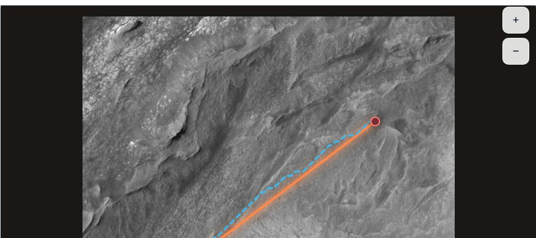

# Terrain preview integration (Planning V2) — 20 Nov 2026

Coordinator integration on `claude/magical-volta-1c76ak`. The active image is now the HiRISE orthoimage crop `hirise-psp001752-red-ortho-2048-0253m-v3` with the accepted 1 m DTM package (decision and evidence: [ACCEPTANCE.md](../data/terrain-v2/ACCEPTANCE.md), [REGISTRATION.md](../data/terrain-v2/REGISTRATION.md)).

## What's connected

| Piece | Source | Where it runs |
|---|---|---|
| Package loader + gate | `core/terrain.service.ts` | lazy chunk, started when the planner tab opens |
| Routing worker | `terrain/terrain-routing.worker.ts` (Enzo 2 branch) | own 6.9 kB worker bundle, in the offline pack |
| Planner controls | `terrain-planner/` (Emma 1, with review fixes) | lazy `terrain-preview` chunk under Route Planner |
| Evidence view | `terrain-evidence/` (Emma 2, with review fix) | same chunk |
| Coordinator glue | `terrain/terrain-preview.service.ts`, `terrain-preview.component.ts` | same chunk |
| Map suggestion | `core/terrain-suggestion.store.ts` + `map.component.ts` (dashed line, own layer, cleared on image change) | main bundle (signal only) |
| Accept | `MissionService.replaceRouteFromSuggestion` (undo-able, not saved; provenance stored on save) | main bundle |

## Results

- `npm test`: **412 / 412** (adds preview-service integration, review-fix and real-package tests). `npm run test:pwa`: 18 / 18. `npm run build`: passes; offline pack 29 files, 10.5 MB, including the terrain package and worker.
- Real browser (`tests/planning-v2/terrain-preview.e2e.cjs`, Chromium 157, production build, local origin):
  - Prepare offline → Pack verified. Set endpoints. Request preview → "Preview suggestion (not saved)", 392.1 m, max 8.7°, dashed line drawn.
  - Accept → route replaced (30 waypoints), dashed line cleared. Save → envelope carries `terrainSuggestion` provenance.
  - Full browser restart **offline** → saved route intact; a new preview computes offline (521.1 m, 15.0°). No page or console errors in either session.

## Known limits

- Initial bundle 518 kB (main 499 kB) vs the 500 kB budget. It was already 509.85 kB before this work; the eager growth is the accept adapter in `MissionService`. The terrain UI is lazy (64 kB).
- The map still starts below the fold on laptops (usability audit #1). Not fixed here.
- Not tested: physical phones, the deployed origin, Takou's harness with Chrome.
- Open conditions on the acceptance: Willy 2's control-point check and the HiRISE usage terms.
